<p align="center">
  
</p>

<p align="center">
  <b>Proxy &amp; server store</b>: ISP, residential, datacenter and private proxies, VPS and dedicated servers.<br>
  Proxies are ready within 3–5 minutes after payment.
</p>

<p align="center">
  <a href="https://ipdokan.com">Website</a> ·
  <a href="https://t.me/IpDokan">Telegram</a> ·
  <a href="backend/README.md">API docs</a> ·
  <a href="docs/ipdokan-system-design.pdf">System design</a>
</p>

---

## Demo

<p align="center">
  <a href=".github/assets/demo.mp4">
    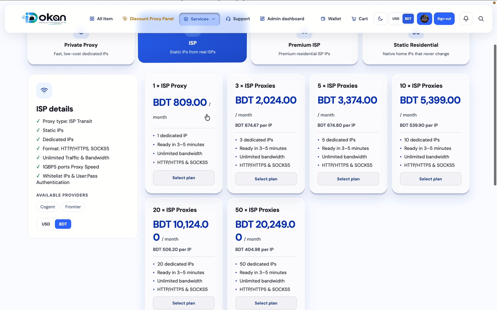
  </a>
  <br>
  <a href=".github/assets/demo.mp4"><b>▶ Watch the demo video</b></a> (40 seconds)
</p>

## Screenshots

<table>
  <tr>
    <td width="50%" align="center">
      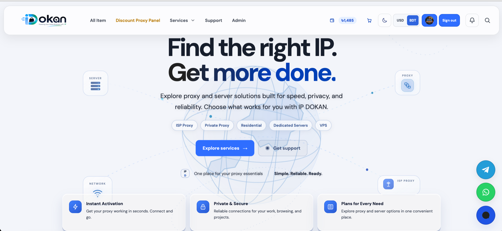
      <br><sub><b>Home page</b>: find the right IP for your needs</sub>
    </td>
    <td width="50%" align="center">
      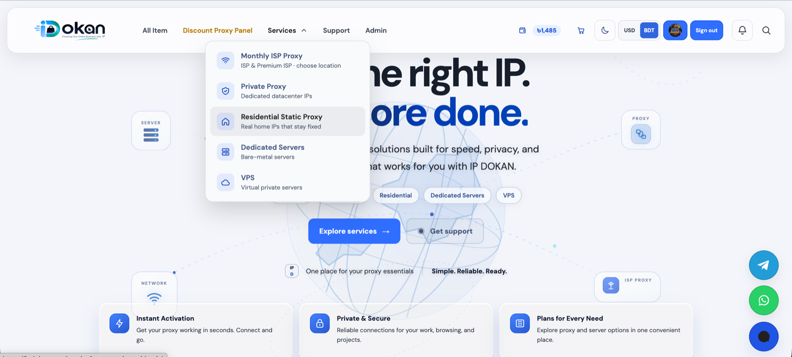
      <br><sub><b>Services menu</b>: ISP, private and residential proxies, dedicated servers, VPS</sub>
    </td>
  </tr>
  <tr>
    <td width="50%" align="center">
      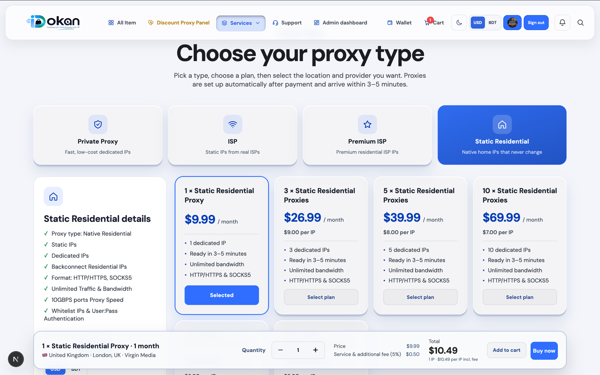
      <br><sub><b>Choose a proxy type and plan</b>: Private, ISP, Premium ISP and Static Residential</sub>
    </td>
    <td width="50%" align="center">
      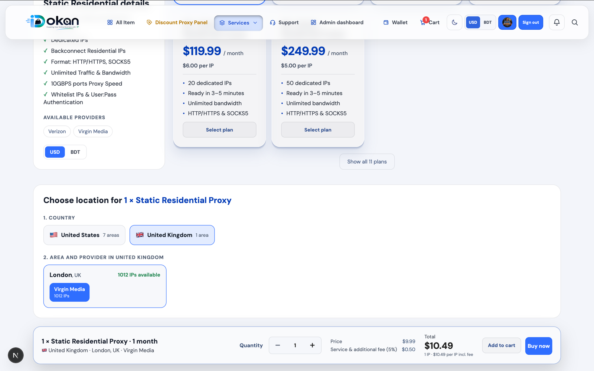
      <br><sub><b>Pick a country, area and provider</b>, then add to cart or buy now</sub>
    </td>
  </tr>
  <tr>
    <td width="50%" align="center">
      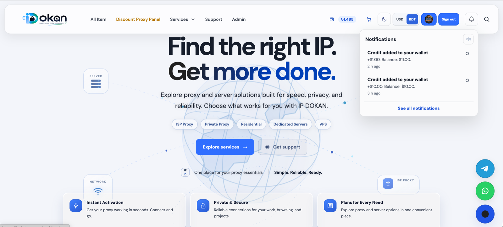
      <br><sub><b>Real-time notifications</b>: wallet credits and order updates</sub>
    </td>
    <td width="50%" align="center">
      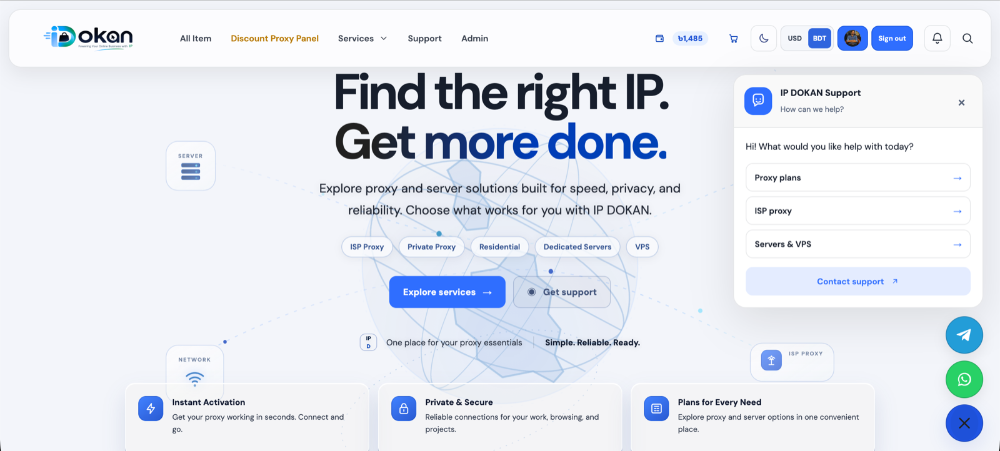
      <br><sub><b>Support chat</b>: quick help for plans, ISP proxies, servers and VPS</sub>
    </td>
  </tr>
  <tr>
    <td width="50%" align="center">
      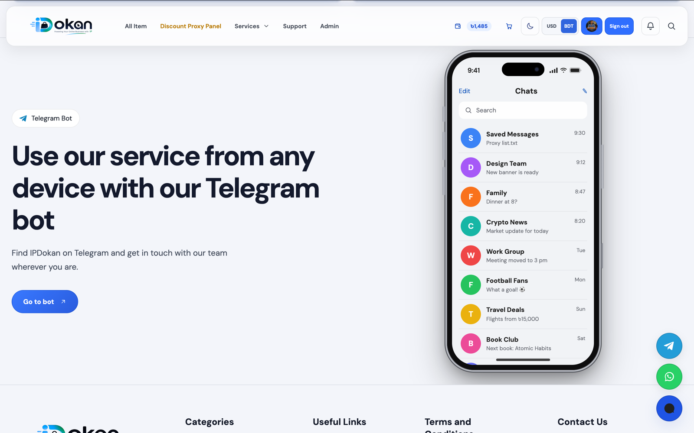
      <br><sub><b>Telegram bot</b>: use the service from any device</sub>
    </td>
    <td width="50%" align="center">
      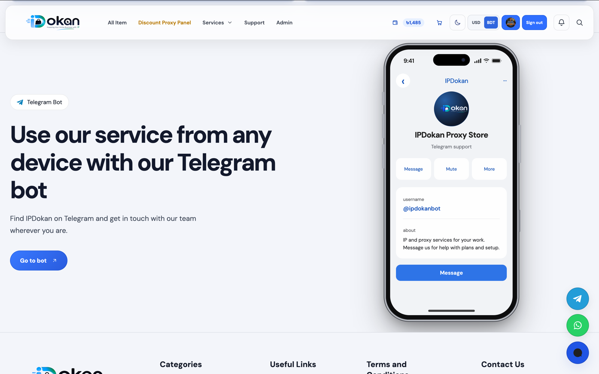
      <br><sub><b>@ipdokanbot</b>: the IPDokan Proxy Store on Telegram</sub>
    </td>
  </tr>
  <tr>
    <td width="50%" align="center">
      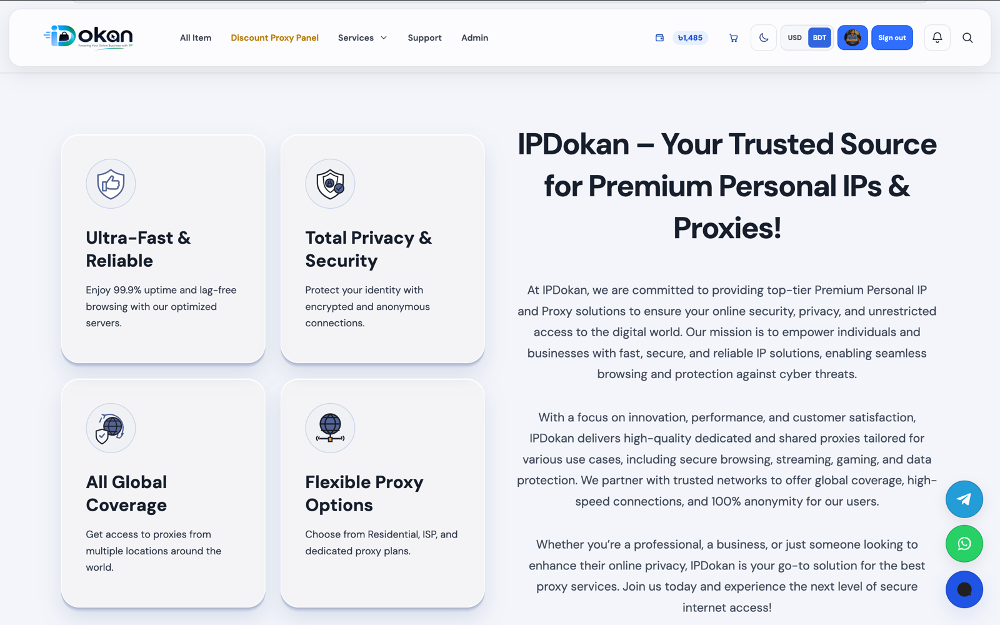
      <br><sub><b>Why IP Dokan</b>: speed, privacy, global coverage, flexible plans</sub>
    </td>
    <td width="50%" align="center">
      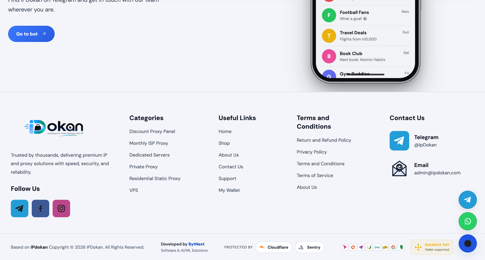
      <br><sub><b>Footer</b>: categories, links, contact, Cloudflare and Sentry protection</sub>
    </td>
  </tr>
</table>

## About

IP Dokan is a full-stack online store for proxies and servers. Customers browse the catalog, pay with
bKash/Nagad, crypto or card, and get their proxy credentials delivered to their profile automatically.
Admins manage products, stock, orders, wallets and suppliers from a built-in admin panel.

### Features

- **Catalog and checkout**: product pages, a browser cart, "buy now", and BDT/USD pricing.
- **Payments**: ZiniPay (bKash/Nagad, BDT), Cryptomus (crypto, USD), and Stripe Checkout (card).
- **Wallet**: customers top up a balance and pay from it; admins can credit wallets and review top-ups.
- **Automatic delivery**:
  - Stocked products deliver unique codes from inventory as soon as payment is confirmed.
  - Supplier products are ordered from the MyProxyApi reseller API after payment and delivered when ready, with background retries.
- **Accounts**: email/password with an email OTP, Google sign-in, sessions and OAuth 2.1 tokens via
  [Better Auth](https://www.better-auth.com/), protected by Cloudflare Turnstile.
- **Real-time notifications**: order and payment updates reach open tabs over Socket.IO.
- **Admin panel** (`/admin`): products, stock and delivery codes, orders, users, earnings dashboard, supplier plans,
  wallet top-ups, and a maintenance/dev mode.
- **Telegram bot bridge**: sales made through the IP Dokan Telegram bot use the same inventory and appear in the admin panel.
- **Light and dark themes**, a Bengali-first UI, and SEO metadata, a sitemap and robots.txt.

### Tech stack

| Layer      | Technology |
| ---------- | ---------- |
| Frontend   | Next.js (App Router), React, Recharts |
| API        | Node.js, Express 5 |
| Database   | MongoDB (Mongoose + Better Auth MongoDB adapter) |
| Queue/cache | Redis, BullMQ, Socket.IO Redis adapter |
| Auth       | Better Auth (email/password, Google, JWT, OAuth provider) |
| Payments   | ZiniPay, Cryptomus, Stripe |
| Media/mail | Cloudinary, Nodemailer (SMTP) |
| Hosting    | VPS: nginx, pm2 (cluster mode), Docker (Redis), Cloudflare |

## Project structure

```
app/          Next.js routes (catalog, product, checkout, wallet, profile, admin, sign-in, …)
components/   UI: layout (header, footer, theme), sections (pages), ui (shared pieces)
lib/          Frontend helpers (auth client, cart, realtime, currency, …)
styles/       Global CSS and light/dark themes
public/       Logos, partner images, icons, sounds
backend/      Express API: server.js, worker.js, routes, controllers, models, lib
deploy/       VPS deploy scripts, nginx config, pm2 ecosystem, Redis docker-compose
scripts/      Build helpers (theme generation)
docs/         System design document
```

## Getting started

### Requirements

- **Node.js** 20 or newer (developed on Node 24)
- **MongoDB**: a local instance or MongoDB Atlas (needed once authentication is enabled)
- **Redis** (optional for local development; without it, everything runs in one process)

### 1. Install

```bash
git clone <repository-url> ipdokan
cd ipdokan
npm install
```

### 2. Configure

```bash
cp .env.example .env
```

For a first run, the defaults are enough: `AUTH_ENABLED=false` starts the site and API without any
credentials. To use sign-in, orders and payments, fill in at least:

| Variable | Purpose |
| -------- | ------- |
| `AUTH_ENABLED=true` | Turns on accounts and orders |
| `MONGODB_URI` | MongoDB connection string |
| `BETTER_AUTH_SECRET` | A long random secret (`openssl rand -base64 32`) |
| `ADMIN_EMAILS` | Comma-separated emails allowed into `/admin` |

Everything else (Google sign-in, Turnstile, ZiniPay, Cryptomus, Stripe, MyProxyApi, Cloudinary,
SMTP, Redis) is optional and documented inline in [.env.example](.env.example). Never commit `.env`;
it is git-ignored.

### 3. Run

Start the API and the website in two terminals:

```bash
# Terminal 1: Express API on http://localhost:4000
npm run backend:dev

# Terminal 2: Next.js site on http://localhost:3000
npm run dev
```

If `REDIS_URL` is set, also start the background worker (OTP emails, order expiry, supplier deliveries):

```bash
# Terminal 3
npm run worker:dev
```

Open **http://localhost:3000**.

### Demo admin (local only)

```bash
# in .env: DEMO_ADMIN_ENABLED=true, DEMO_ADMIN_EMAIL=demo-admin@example.com
npm run backend:seed-demo-admin
```

The command prints a generated password if `DEMO_ADMIN_PASSWORD` is empty. It refuses to run in production.

## Scripts

| Command | Description |
| ------- | ----------- |
| `npm run dev` | Next.js dev server (port 3000) |
| `npm run build` | Production build of the website |
| `npm run start` | Serve the production build |
| `npm run lint` | ESLint |
| `npm run backend:dev` | API with auto-reload (port 4000) |
| `npm run backend:start` | API without auto-reload |
| `npm run worker:dev` | BullMQ background worker with auto-reload |
| `npm run backend:seed-demo-admin` | Create the local demo admin account |
| `npm run theme:light` | Regenerate the light and dark theme CSS |

## Testing payments locally

With a Stripe test key (`sk_test_…`), forward webhooks to the API:

```bash
stripe listen --forward-to localhost:4000/api/payments/stripe/webhook
```

Put the printed signing secret in `STRIPE_WEBHOOK_SECRET` and pay with the test card `4242 4242 4242 4242`.

## Deployment

Production runs on a single VPS behind Cloudflare and nginx. From the project root:

```bash
bash deploy/deploy.sh
```

This shows a maintenance page, syncs the code to the server (without `.env` or `node_modules`) and runs
[deploy/server-setup.sh](deploy/server-setup.sh) on the server. The setup script installs dependencies, starts Redis in Docker,
applies the nginx config, builds Next.js and reloads pm2.

The pm2 processes ([deploy/ecosystem.config.cjs](deploy/ecosystem.config.cjs)) are:

- `ipdokan-api`: 3 API instances in cluster mode
- `ipdokan-web`: 2 Next.js instances
- `ipdokan-worker`: 1 background worker

The server keeps its own production `.env` in `/var/www/ipdokan/.env`.

## Documentation

- [backend/README.md](backend/README.md): API endpoints, auth/OAuth flow, orders, and the MyProxyApi integration
- [docs/ipdokan-system-design.pdf](docs/ipdokan-system-design.pdf): system design overview

## License

Private and proprietary. All rights reserved.
